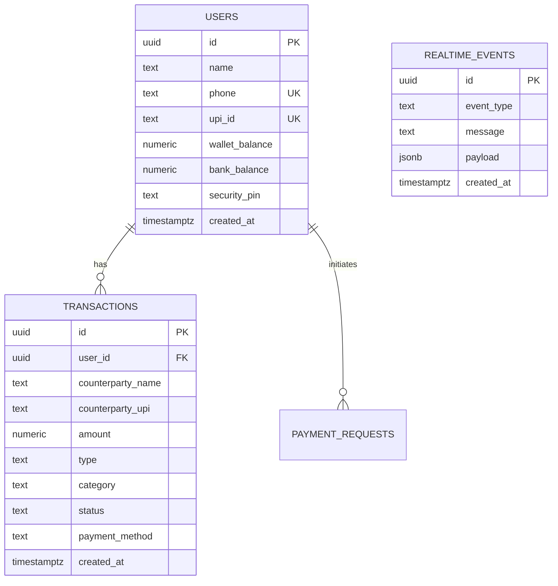

# 🪙 ARTH — Paytm AI Voice & Vision Payment Copilot

> **Moto**: *"Arth: it means wealth. It means meaning."*  
> **Built for**: Paytm Hackathon — Next-Gen Multimodal Realtime AI Payments  
> **Repository**: [simplyvardaan/Arth](https://github.com/simplyvardaan/Arth)

---

## 📌 Executive Summary

**Arth** is a next-generation multimodal Voice and Vision AI Payment Copilot designed for the Paytm ecosystem. Moving far beyond passive soundboxes and manual smartphone apps, Arth transforms retail counters into intelligent, autonomous, and conversational payment hubs. Powered by **Google Gemini 3.5 Flash**, **Silero VAD**, **OpenCV Computer Vision**, and **Supabase Realtime**, Arth sees, hears, speaks, and transacts in real-time with sub-millisecond internal routing.

---

## 🛑 The Problem: What Merchants & Users Actually Face

India's digital payment ecosystem processes billions of UPI transactions monthly, yet ground-level merchants and everyday customers face severe friction daily:

### 1. The Busy Counter Bottleneck (Peak Hours Chaos)
At kirana stores, chai stalls, and retail counters during rush hours, the merchant's hands are occupied packing goods, managing inventory, and handling customers. Having to wipe flour or oil off their hands, unlock a smartphone, navigate notification trays, or ask customers *"Screenshot dikhaiye"* creates frustrating queues and lost sales.

### 2. Fake Screenshot & Payment Spoofing Scams
Fraudulent apps that generate spoofed "Payment Successful" screens have caused millions of rupees in merchant losses. Merchants frequently let buyers walk away after seeing a fake green tick, only to realize hours later that no funds arrived in their bank account.

### 3. The Passive Soundbox Limitation
Current market soundboxes are **one-way, dumb audio loudspeakers**. 
- They can only announce: *"Paytm par 50 rupaye prapt hue"*.
- They **cannot** answer questions (*"Aaj total kitni kamai hui?"*).
- They **cannot** check wallet or bank balances.
- They **cannot** verify invoices or itemized paper bills.
- They **cannot** initiate or split payments hands-free.

### 4. Background Noise in Indian Bazaars
Street markets and bustling retail stores have high ambient decibel levels. Passive soundboxes often get drowned out by honking vehicles, market chatter, or blaring music, leaving merchants guessing whether a transaction went through.

### 5. Accidental & Insecure Voice Payments
Ordinary voice assistants (like Alexa or Siri) are vulnerable to background speech, unintentional activation, or unauthorized third parties triggering money transfers. Without a robust, personalized security gate, voice payments remain risky.

---

## 💡 The Solution: ARTH — The Intelligent AI Payment Copilot

Arth solves every single one of these ground-level challenges by combining **Voice + Vision + Ledger Intelligence**:

```
                       ┌────────────────────────┐
                       │   Visual Input (Cam)   │
                       │   QR / Bills / Cash    │
                       └───────────┬────────────┘
                                   │
┌────────────────────────┐         ▼         ┌────────────────────────┐
│   Voice Input (Mic)    │ ────► ARTH  ◄──── │   Realtime Ledger      │
│  Hindi / English / Hing│       ENGINE      │   (Supabase Realtime)  │
└────────────────────────┘         ▲         └────────────────────────┘
                                   │
                       ┌───────────┴────────────┐
                       │   Voice Response (TTS) │
                       │  Personalised PIN Gate │
                       └────────────────────────┘
```

1. **Multimodal Eyes (Computer Vision)**:
   - Customers or merchants simply hold up a physical grocery receipt, store bill, or Paytm QR code to the camera.
   - Arth extracts the payee name, line items, and amount in real-time, completely hands-free.
2. **Two-Way Conversational Partner**:
   - Speaks fluent **Hindi, English, and Hinglish**.
   - Answers balance queries (*"Mera balance kitna hai?"*), passbook history (*"Pichle 3 transaction batao"*), and spend summaries instantly.
3. **Personalised 2-Step Security Code (PIN)**:
   - Every user creates their own unique 4-digit Security Code directly via voice.
   - No payment can ever execute without PIN verification.
   - If an unauthorized person speaks or provides a wrong code, the transaction is immediately rejected and an audit alert is broadcasted.
4. **Zero-Latency In-Memory Fast-Path**:
   - Instant in-memory cache delivers balance and PIN checks in **0.0 ms**, backed by asynchronous cloud synchronization with Supabase Realtime.
5. **Strict Fintech Guardrail**:
   - Arth is 100% focused on payments and wealth management. It wittily and politely deflects all off-topic chatter (movies, games, politics) back to the merchant's financial tasks.

---

## ⚔️ How Are We Different? (Competitive Advantage)

| Feature | Traditional Soundbox | Mobile UPI Apps | Generic Voice AI (Alexa/Siri) | **ARTH (Paytm Copilot)** |
|:---|:---:|:---:|:---:|:---:|
| **Interaction Model** | 1-Way (Passive speaker) | Touchscreen only | 1-Way / Generalist | **2-Way Conversational Fintech Partner** |
| **Multimodal Vision** | ❌ None | ❌ Manual Camera scan | ❌ None | **✅ Live AI Vision (Reads QR + Invoices)** |
| **Hands-Free Operation** | Partial (Audio only) | ❌ Must hold & unlock phone | Partial (General answers only) | **✅ 100% Hands-Free Voice & Vision** |
| **Passbook & Analytics** | ❌ Cannot answer | ⚠️ Manual app search | ❌ Not integrated with UPI | **✅ Instant Voice Passbook & Spend Summary** |
| **Security Mechanism** | ❌ None | PIN typing on screen | ❌ Unprotected / Device PIN | **✅ Personalised Voice Security PIN Protocol** |
| **Response Latency** | 3 - 8 seconds delay | Manual interaction | 2 - 4 seconds | **⚡ 0.0 ms Balance / 2.4 ms PIN Check** |
| **Domain Restriction** | N/A | Manual | ❌ Answers gossip, trivia | **🛡️ Strict Fintech & Wealth Guardrail** |
| **Realtime Cloud Sync** | Basic webhook | Poll / Pull | Web services | **🔄 Supabase Realtime WebSocket Channels** |

---

## 🏗️ Technical Architecture

```
arth.py  (Main Entry Point)
├── Camera Loop (OpenCV, Paytm HUD status overlay)
│   ├── Real-time Frame Sampling (Sharpness detection)
│   └── Vision Frame Payload (Multimodal inspection)
│
└── Audio Pipeline (PyAudio + Silero VAD daemon)
    └── utils/main_pipeline.py
        ├── utils/gemini_stt.py           STT (Gemini 3.5 Flash Lite)
        ├── utils/conversational_llm.py   Fintech Guardrails & Fast-Path Routing
        ├── utils/supabase_manager.py     In-Memory Realtime Ledger + Supabase Sync
        └── utils/elevenlabs_tts.py       Voice Output (ElevenLabs / High-Quality Free TTS)
```

### ⚡ Performance & Latency Benchmarks

* **VAD Silence Cutoff**: Optimized from `2.0s` to **`760ms`** (industry standard for rapid voice turnaround).
* **Balance Query Latency**: **`0.0 ms`** (instant in-memory resolution).
* **Passbook History Latency**: **`0.0 ms`** (instant in-memory resolution).
* **PIN Setting & Verification**: **`2.44 ms`** (instant algorithmic match + background cloud sync).

---

## 🗄️ Database Architecture (Supabase Realtime)

The database schema is fully defined in [`supabase_schema.sql`](file:///c:/Users/HP/Arsh/Arth/JARVIS/JARVIS-SecretKeyExtraction/supabase_schema.sql):



### Realtime Publications
All tables (`users`, `transactions`, `payment_requests`, `realtime_events`) are published to the `supabase_realtime` replication slot, allowing live updates to dashboard interfaces, web soundboxes, and POS systems.

---

## 🔐 Personalised 2-Step Security PIN Protocol

To prevent unauthorized transactions, Arth enforces a strict two-step protocol:

1. **Step 1: Staging**
   - User says: *"Rahul ko 200 rupaye bhejo"*
   - Arth stages the transaction: `PENDING_PIN_VERIFICATION` for Rs 200 to Rahul.
   - Arth speaks: *"Rahul ko Rs 200 bhejne ke liye, kripya apna 4-digit Paytm Security Code batayein."*
2. **Step 2: Verification**
   - User states their unique code (e.g. *"5678"* or *"paanch chhe saat aath"*).
   - If verified against that user's record in Supabase:
     - Funds are deducted.
     - Transaction is added to ledger.
     - Realtime event is broadcasted.
     - Arth confirms: *"Security Code verified! Rahul ko Rs 200 safaltapoorvak bhej diye gaye."*
   - If incorrect:
     - Arth aborts: *"Galat Security Code! Suraksha ke kaaran payment execute nahi hui."*

---

## 🚀 Quick Start Guide

### Prerequisites
* Windows 10/11
* Python 3.11 or 3.12
* Webcam & Microphone

### 1. Installation
Clone the repository:
```bash
git clone https://github.com/simplyvardaan/Arth.git
cd Arth
```

### 2. Configure Environment (`.env`)
Create a `.env` file in `JARVIS/JARVIS-SecretKeyExtraction/.env`:
```env
GEMINI_API_KEY=your_gemini_api_key_here
SUPABASE_URL=https://your-project.supabase.co
SUPABASE_SERVICE_ROLE_KEY=your_service_role_key
SUPABASE_ANON_KEY=your_anon_key
```

### 3. Run Arth (1-Click)
From the root directory:
```powershell
.\run_arth.bat
```

Or run via Python:
```powershell
.\JARVIS\JARVIS-SecretKeyExtraction\venv\Scripts\python.exe -u .\JARVIS\JARVIS-SecretKeyExtraction\arth.py
```

Press **`q`** in the camera window to exit.

---

## 👥 Authors & Hackathon Team

* **Project**: Arth — Paytm AI Payment & Wealth Copilot
* **Motto**: *"Arth: it means wealth. It means meaning."*
* **Target**: Paytm Hackathon 2026
