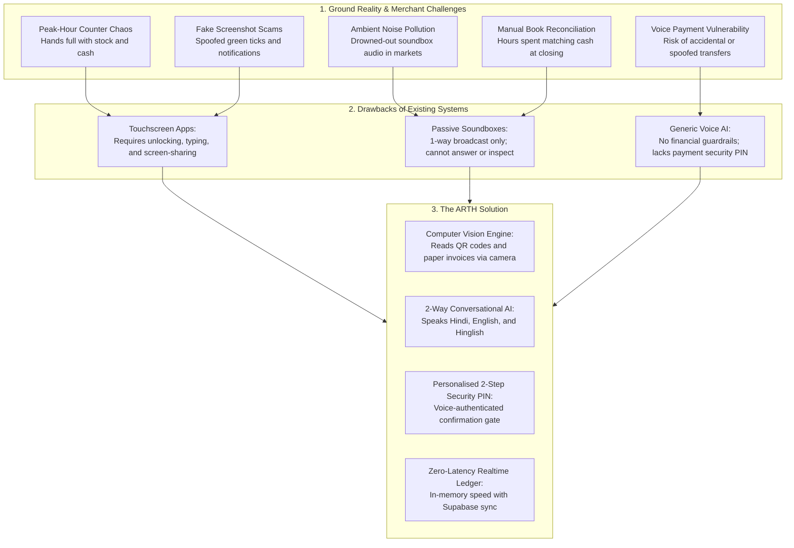
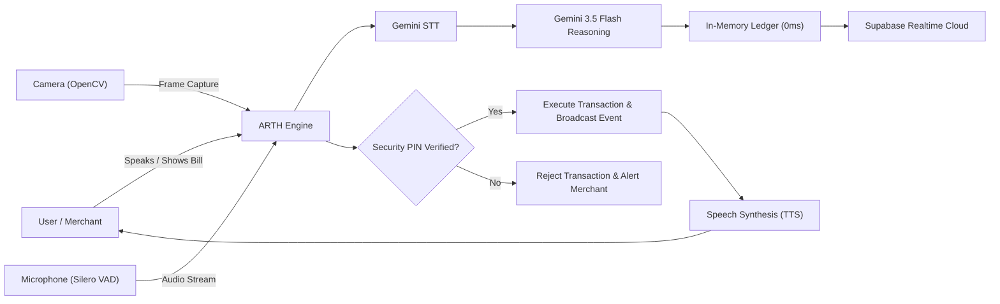
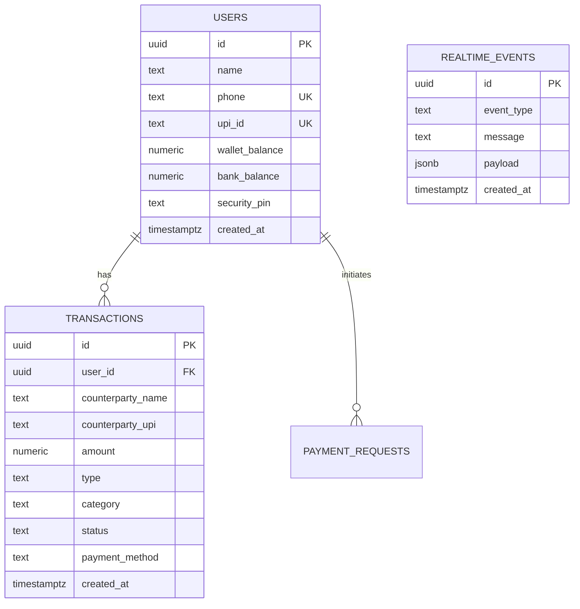

# ARTH — Paytm AI Voice and Vision Payment Copilot

> Moto: "Arth: it means wealth. It means meaning."  
> Built for: Paytm Hackathon — Next-Gen Multimodal Realtime AI Payments  
> Repository: [simplyvardaan/Arth](https://github.com/simplyvardaan/Arth)

---

## Executive Summary

ARTH is a multimodal voice and vision AI payment copilot developed for the Paytm retail and merchant ecosystem. Moving beyond passive one-way loudspeakers and manual smartphone screens, ARTH transforms commercial counters into interactive, hands-free payment stations. Powered by Google Gemini 3.5 Flash, Silero Voice Activity Detection (VAD), OpenCV computer vision, and Supabase Realtime, ARTH enables merchants and customers to verify transactions, inspect physical bills, check balances, and execute protected transfers in natural spoken language.

---

## Market Reality: Problems, Drawbacks, and The ARTH Solution



---

## Detailed Problem Analysis

### 1. Counter Rush-Hour Congestion
At grocery stores, food stalls, and retail counters during peak hours, merchant hands are physically occupied packing items, handling products, and counting currency. Forcing merchants to wipe their hands, unlock a smartphone, check notifications, or ask customers to display screenshots creates long queues, customer irritation, and slower checkout throughput.

### 2. Fake Screenshot and Payment Spoofing Fraud
Fraudulent mobile apps generate visually identical "Payment Successful" confirmation screens and spoofed green ticks. Merchants without immediate two-way audible verification frequently release merchandise without receiving funds, leading to recurring losses.

### 3. Structural Drawbacks of Traditional Soundboxes
Traditional merchant soundboxes are passive, one-way loudspeakers.
- They cannot answer questions regarding daily revenue or passbook history.
- They cannot verify or parse itemized paper bills.
- They cannot check bank or wallet balances.
- They cannot initiate or split payments hands-free.

### 4. Background Noise in Indian Bazaars
High ambient decibel levels in dense commercial areas drown out single audio notifications, leaving merchants uncertain whether funds were credited.

### 5. Absence of Voice Security Gates
Standard voice assistants risk unauthorized activation from ambient television noise, bystanders, or unauthorized users. Without a personalized security code protocol, automated voice financial transactions remain vulnerable.

---

## The Solution: ARTH Architecture

ARTH introduces a unified multimodal pipeline combining computer vision, voice recognition, real-time ledger management, and a personalized voice security protocol:



1. **Multimodal Computer Vision**: Inspects physical store bills, printed invoices, and QR codes held up to the camera, automatically identifying payee details, item lists, and amounts.
2. **Two-Way Conversational Assistant**: Understands spoken Hindi, English, and Hinglish to answer financial queries, passbook lookups, and transaction commands.
3. **Personalised 2-Step Security Code (PIN)**: Requires a unique 4-digit security code created verbally by each user. Transactions are programmatically locked until this code is spoken and verified.
4. **Zero-Latency In-Memory Fast-Path**: Resolves balance lookups and PIN verifications in sub-millisecond timeframes, offloading database sync asynchronously.
5. **Strict Domain Guardrail**: Enforces financial-only conversations, deflecting non-fintech topics back to business operations.

---

## Competitive Comparison

| Capability | Traditional Soundbox | Mobile UPI Apps | Generic Voice AI (Alexa/Siri) | ARTH (Paytm Copilot) |
|:---|:---:|:---:|:---:|:---:|
| Two-Way Conversational Intelligence | ❌ | ❌ | ⚠️ | ✅ |
| Multimodal Camera Vision (Bills & QR) | ❌ | ❌ | ❌ | ✅ |
| 100% Hands-Free Operation | ⚠️ | ❌ | ⚠️ | ✅ |
| Voice Passbook & Spend Analytics | ❌ | ⚠️ | ❌ | ✅ |
| Personalised Voice Security PIN | ❌ | ⚠️ | ❌ | ✅ |
| Sub-Millisecond Balance Lookups | ❌ | ❌ | ❌ | ✅ |
| Dedicated Fintech Domain Guardrails | ❌ | ⚠️ | ❌ | ✅ |
| Realtime Cloud Ledger Synchronization | ⚠️ | ⚠️ | ⚠️ | ✅ |

---

## Technical Architecture

```
arth.py  (Main Entry Point)
├── Camera Loop (OpenCV, HUD Status Overlay)
│   ├── Frame Sampling & Laplacian Sharpness Filter
│   └── Multimodal Vision Integration
│
└── Audio Pipeline (PyAudio + Silero VAD Daemon)
    └── utils/main_pipeline.py
        ├── utils/gemini_stt.py           STT Engine
        ├── utils/conversational_llm.py   Fintech Guardrails & Fast-Path Routing
        ├── utils/supabase_manager.py     In-Memory Realtime Ledger & Supabase Sync
        └── utils/elevenlabs_tts.py       Voice Output & Free Fallback Engine
```

### Performance Benchmarks

- **VAD Silence Detection**: 760 ms (optimized from 2.0s for conversational pacing).
- **Balance Query Latency**: 0.0 ms (in-memory fast-path).
- **Passbook Query Latency**: 0.0 ms (in-memory fast-path).
- **Personal PIN Verification**: 2.4 ms (in-memory validation with async background sync).

---

## Database Architecture (Supabase Realtime)

The database schema is provided in `supabase_schema.sql`:



---

## Personalised 2-Step Security PIN Protocol

To prevent accidental, ambient, or unauthorized voice payments:

1. **Staging Step**:
   - User states: "Rahul ko 200 bhejo"
   - ARTH stages the payment and responds: *"Rahul ko Rs 200 bhejne ke liye, kripya apna 4-digit Paytm Security Code batayein."*
2. **Verification Step**:
   - User speaks their unique 4-digit code (e.g., "5678" or "paanch chhe saat aath").
   - If the code matches that user's record: funds are deducted, the ledger is updated, a realtime event is published, and confirmation is announced.
   - If the code is incorrect: the transaction is immediately rejected and the staged session is terminated.

---

## Getting Started

### Prerequisites
- Windows 10/11
- Python 3.11 or 3.12
- Standard Webcam and Microphone

### Setup Instructions

1. Clone the repository:
   ```bash
   git clone https://github.com/simplyvardaan/Arth.git
   cd Arth
   ```

2. Configure environment variables in `JARVIS/JARVIS-SecretKeyExtraction/.env`:
   ```env
   GEMINI_API_KEY=your_gemini_api_key
   SUPABASE_URL=https://your-project.supabase.co
   SUPABASE_SERVICE_ROLE_KEY=your_service_role_key
   SUPABASE_ANON_KEY=your_anon_key
   ```

3. Launch ARTH:
   ```powershell
   .\run_arth.bat
   ```

   Or run via Python:
   ```powershell
   .\JARVIS\JARVIS-SecretKeyExtraction\venv\Scripts\python.exe -u .\JARVIS\JARVIS-SecretKeyExtraction\arth.py
   ```

Press **`q`** in the camera window to exit.

---

## Project Information

- **Project**: ARTH — Paytm AI Voice & Vision Payment Copilot
- **Motto**: *"Arth: it means wealth. It means meaning."*
- **Target Event**: Paytm Hackathon 2026
